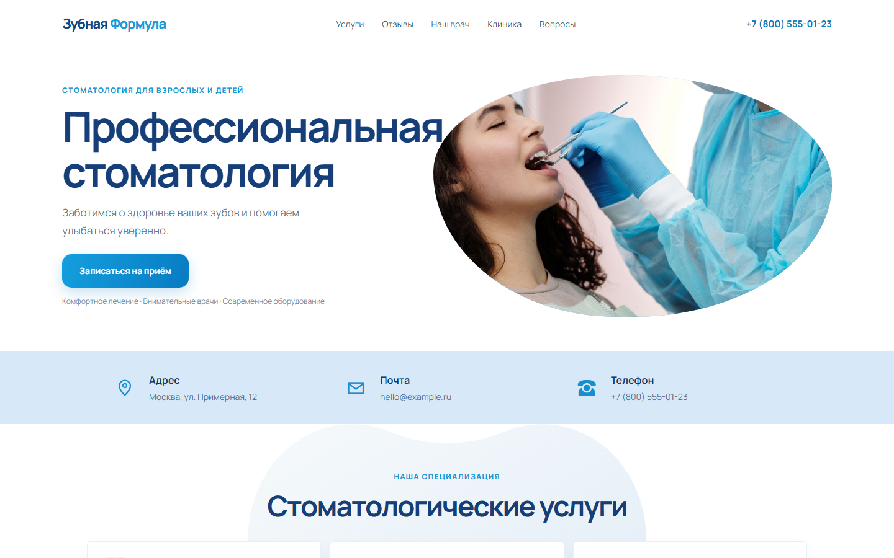
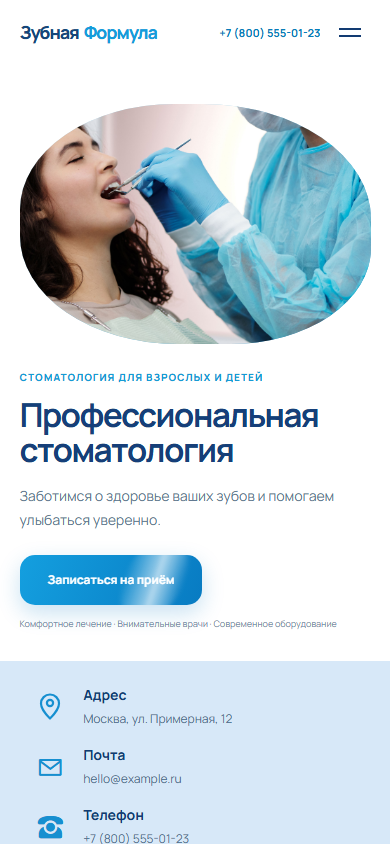

# Зубная Формула — лендинг стоматологической клиники

Адаптивный демонстрационный лендинг, свёрстанный по макету Figma Community. Название, клиника, врач и контакты вымышленные.

[Открыть сайт](https://vladdolgopolenko.github.io/dentist-landing/)

Посмотреть мобильную версию

## Возможности

- адаптивные секции и мобильная навигация;
- галерея клиники на Swiper с автопрокруткой и пагинацией;
- раскрывающийся FAQ;
- клиентская проверка имени и телефона в форме записи;
- интерактивная карта OpenStreetMap с общим обзором Москвы; точного адреса и метки клиники нет.

Форма работает как демонстрация интерфейса и не отправляет данные. Для реальной записи потребуется подключить серверную обработку или сервис форм.

## Технологии

- HTML5, CSS3, JavaScript;
- Swiper 12 подключается через jsDelivr CDN;
- фотографии Pexels хранятся в проекте в формате WebP, карта OpenStreetMap и шрифт Google Fonts загружаются из интернета.

## Структура

- `index.html` — разметка страницы;
- `styles/main.css` — стили и адаптивные правила;
- `scripts/main.js` — мобильное меню, проверка формы и настройка слайдера.
